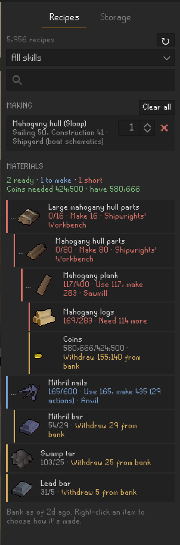
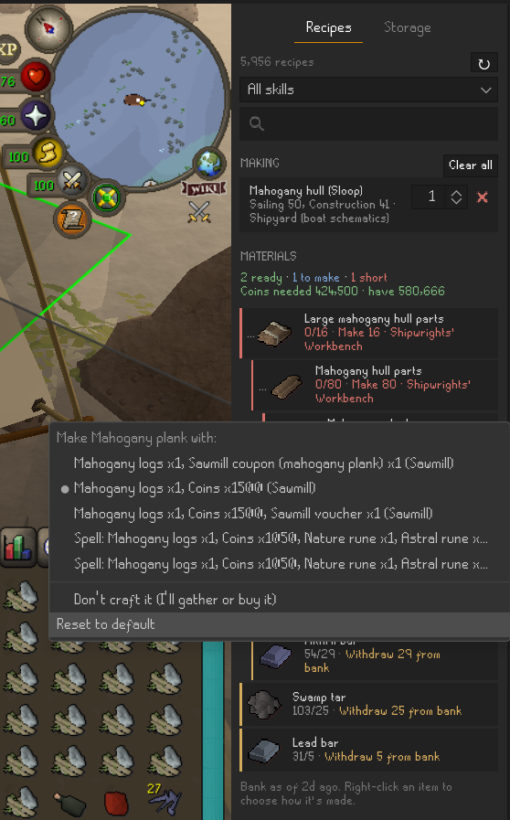
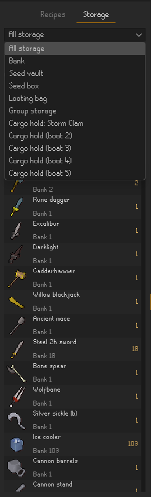

# Material Planner (RuneLite plugin)

Plan what you need for anything you can make in OSRS, counting what you already own across your bank and other storage.

<p>
  
  
  
</p>

*Left: one sloop hull planned down to raw materials. Middle: right-click any ingredient to choose how it's made. Right: everything you own across your bank, seed vault, cargo holds and other storage.*

## Recipes tab

- Type in the search box for a live dropdown, or choose a skill to browse everything in that skill.
- Click a recipe to add it. Plan it by **count** (how many times you'll make it) or by **level goal**: pick a target level and the plugin works out how many actions get you there. Level goals chain: by default each step starts where the step above it (same skill) ends, so you can plan potion A from 50 to 53, potion B from 53 to 56 and so on. Switch a step's start from **Auto** to **Set** to choose its starting level yourself. A step whose level requirement is reached by an earlier step isn't flagged as too high. Add as many recipes as you like; materials are combined.
- **Sub-recipes are planned automatically.** If you're missing an ingredient that can be crafted, the plugin plans its ingredients too, all the way down to raw materials. Stock you already have is used first at every level, and is shared across the whole plan so nothing is counted twice.
- **Choose how things are made.** By default the plugin picks a method you can actually do with what you own (it won't send you to a sawmill coupon you don't have). Right-click any material to pick a different method, for example sawmill vs. Plank Make, or to say you'll gather or buy it instead. Your choices are remembered.
- Each material is color-coded:
  - **green** – enough on you now
  - **orange** – enough once you withdraw from the bank or other storage
  - **blue** – will be crafted (expand the arrow to see its ingredients)
  - **red** – short, with the exact amount still needed
- **Access checks** flag recipes and crafting steps your levels are too low for, members-only recipes on a free world, and recipes behind a quest you haven't done. Optionally hide those recipes from search.
- **Tools** the plan needs (saw, hammer, chisel and so on) get their own list showing whether each is on you, in the bank, or missing.
- **Trip count**: the overview shows roughly how many inventories of materials the plan takes to carry. Stackable items count as one slot.
- **Shops**: anything you're short that a shop sells shows the cheapest coin shop you can actually use, plus the nearest one when that's a different shop. Shops behind a quest you haven't done (Prifddinas, Keldagrim, Zanaris...), a guild level you don't have, or members-only shops on a free world are left out, and the tooltip says what each one needs.
- **Costs**: coins the plan needs (sawmill fees and similar) plus, optionally, the GE price of everything you're short. "Auto" shows coins only on ironman accounts.
- **Bank highlighting**: items the plan needs from the bank are outlined when you open it.

## Storage tab

The plugin records each of these whenever you open or change it, per account:

| Storage | Recorded when |
|---|---|
| Bank | You open the bank |
| Seed vault | You open the seed vault |
| Looting bag | You check or use the looting bag |
| Seed box | You check or use the seed box |
| Group storage | You open group storage (group ironman) |
| Boat cargo holds 1–5 | You open a boat's cargo hold |
| Tackle box | You check or use the tackle box |
| Forestry kit | You check or use the forestry kit |
| Huntsman's kit | You check or use the huntsman's kit |
| Rune pouch | Always, while the pouch is in your inventory |

View one storage at a time or all together, and search across them. In the combined view, an item kept in more than one place lists how many are in each. Right-click any item in your inventory or on the ground and choose **Check bank** to see how many you have stored.

## Where the recipes come from

On first start the plugin downloads the OSRS Wiki's recipe database (the data behind the wiki's skill calculators) and its shop stock list, and caches both in the plugin's data folder (`~/.runelite/plugin-data/material-planner/`). It re-downloads every 7 days by default, or on demand with the ↻ button. Turning off **Download wiki data** stops all downloads and leaves only the built-in recipes. Data © OSRS Wiki contributors, CC BY-NC-SA 3.0.

The plugin also ships built-in Sailing shipyard recipes (all hulls and mast-and-sails for raft, skiff and sloop), since those vary by boat type.

## Running it

Requires JDK 11+.

```
./gradlew run          (Windows PowerShell: .\gradlew.bat run)
./gradlew test         planner unit tests
```

## Settings

| Section | Setting | Default |
|---|---|---|
| Planner | Expand sub-recipes | on |
| Planner | Show costs | Auto (ironman: coins only) |
| Planner | Check levels | on |
| Planner | Hide recipes above my level | off |
| Planner | Highlight in bank / Highlight color | on / orange |
| Storage | Count equipped items | on |
| Storage | Count other storage | on |
| Storage | 'Check bank' menu option | on |
| Recipe data | Download wiki data | on |
| Recipe data | Recipe refresh (days) | 7 |

## Known limits

- Stored counts are only as fresh as the last time you opened that storage.
- Materials are matched by item name, so an item whose wiki name differs from its in-game name won't match.
- When the wiki lists three same-named Sailing recipes, they're labelled Raft/Skiff/Sloop by material count. That's inferred, not read from the data.
- XP per action and quest requirements come from the wiki's recipe data. Recipes without XP data can only be planned by count, and quest names that don't match RuneLite's quest list aren't checked.
- Shop prices are base prices; most shops charge more as their stock runs down.
- "Nearest" is straight-line distance on the map, not walking or teleport time. Which areas need which quest is a hand-kept list, so a gated area that isn't on it is treated as open.
- POH costume room storage isn't tracked.
